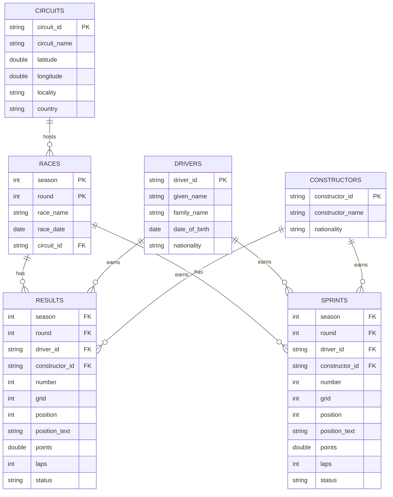

# Databricks Formula 1 Lakehouse Project

End-to-end data engineering project built while learning Databricks on **Azure**. It ingests historical Formula 1 data (1950-2025) from Azure Data Lake Storage Gen2 into a **Unity Catalog** lakehouse using the **medallion architecture** (landing -> bronze -> silver -> gold), with PySpark and Delta Lake.

All notebooks are exported in Databricks **source format** (`.py` / `.sql`). Every notebook includes markdown cells (in Spanish) explaining *what* each step does, *why*, and *how*, with comparisons to Snowflake.

---

## Repository structure

```
.
├── data/
│   └── landing/                                  # Source data (CSV / JSON)
├── Formula1-project/
│   ├── 00-docs/
│   │   └── Formula1 ERD.py                      # Entity relationship diagram + FK validation
│   ├── 01-setup/
│   │   ├── 01.Setup Project Enviorement.sql     # External location, catalog, schemas, volume
│   │   ├── 01.enviorement-config.py             # Central config (catalog/schema names, paths)
│   │   └── 01.bronze-helpers.py                 # Reusable functions (audit columns)
│   ├── 02-bronze/
│   │   ├── ingest_circuits.py
│   │   ├── ingest_races.py
│   │   ├── ingest_constructors.py
│   │   ├── ingest_drivers.py
│   │   ├── ingest result file.py
│   │   ├── ingest sprints json file.py
│   │   └── legacy_ingest_circuits_and_races.py  # First version (circuits + races together)
│   └── 03-silver/
│       ├── 01- transform Circuit data.py
│       └── 02.Transform races data.py
└── notebooks introduction/                       # Course warm-up notebooks
```

To use the notebooks in Databricks: **Workspace > Import** the files, or clone this repo as a **Git folder**.

---

## Source data (`data/landing/`)

| File(s) | Format | Content |
| --- | --- | --- |
| `circuits.csv` | CSV | Circuits |
| `races.csv` | CSV | Races per season |
| `constructors.json` | JSON | Teams |
| `drivers.json` | JSON | Drivers (`name` is a nested object) |
| `results/results_1950.json` ... `results_2025.json` | JSON (one record per line) | Race results, 76 files |
| `sprints/sprints_2021.json` ... `sprints_2025.json` | Multi-line JSON arrays | Sprint results, 5 files |

To reproduce the project (for example on Databricks Free Edition): create a Unity Catalog volume, upload the contents of `data/landing/` to it, and point `landing_folder_path` in `01.enviorement-config` to that volume.

---

## Architecture

```
Azure ADLS Gen2 (container: formula1)
        │   Access Connector + Storage Credential + External Location
        ▼
 landing  ── raw files (CSV / JSON) in a Unity Catalog volume
        ▼
 bronze   ── faithful copy of the source as Delta tables + audit columns
        ▼
 silver   ── cleaned, standardized, deduplicated tables
        ▼
 gold     ── business aggregates (next step)
```

| Layer | Purpose |
| --- | --- |
| Landing | Raw files exactly as delivered: `/Volumes/formula1/landing/files/` |
| Bronze | Source data as Delta tables. Never cleaned, only enriched with `ingestion_timestamps` and `source_file` |
| Silver | snake_case names, descriptive columns, null-key filtering, deduplication, formatting |
| Gold | Reporting-ready aggregates (pending) |

---

## 1. Setup (Azure + Unity Catalog)

Azure connects to Databricks through three pieces:

| Snowflake equivalent | Databricks on Azure | This project |
| --- | --- | --- |
| Storage Integration | Access Connector + Storage Credential | `databricks-course-ext-ac` / `databricks-course-sc` |
| External Stage | External Location | `formula1_ext_location` -> `abfss://formula1@<storage>.dfs.core.windows.net/` |

Steps:
1. In Azure, grant **Storage Blob Data Contributor** on the ADLS Gen2 account to the Access Connector's managed identity.
2. Create the Storage Credential in Databricks.
3. Create the External Location (`01.Setup Project Enviorement.sql`).
4. Create catalog `formula1` with schemas `landing`, `bronze`, `silver`, `gold` (managed locations in the `formula1` container).
5. Create the external volume `formula1.landing.files` on the `landing/` folder.

Notes:
- URLs must use `abfss://` and the `dfs.core.windows.net` endpoint (not `blob`).
- The external location does not store data; it is only governed access to storage.

### Central configuration
`01.enviorement-config` defines `catalog_name`, `bronze_schema`, `silver_schema`, `gold_schema` and `landing_folder_path`. Every notebook loads it with `%run`, so names live in one place.

`01.bronze-helpers` defines `add_ingestion_metadata(df)`, which adds:
- `ingestion_timestamps` -> `current_timestamp()`
- `source_file` -> `_metadata.file_path`

---

## 2. Bronze ingestion

Same pattern in every notebook:
1. Define source path and target table (`catalog.schema.table`).
2. Define an explicit schema (`StructType` or DDL string).
3. Read with `mode = FAILFAST` (fail instead of silently loading bad rows).
4. Add audit columns with `add_ingestion_metadata`.
5. Write as Delta with `mode("overwrite")` (idempotent reruns).
6. Verify with `spark.table(...)`.

| Table | Source | Notes |
| --- | --- | --- |
| `bronze.circuits` | `circuits.csv` | 82 rows |
| `bronze.races` | `races.csv` | 1,178 rows |
| `bronze.constructors` | `constructors.json` | 214 rows |
| `bronze.drivers` | `drivers.json` | 874 rows; `name` is a struct (`givenName`, `familyName`) |
| `bronze.results` | `results/` folder | 25,907 rows, seasons 1950-2025 |
| `bronze.sprints` | `sprints/` folder | 500 rows; multi-line JSON (`multiLine = true`) |

Data quality findings kept in bronze on purpose (cleaned in silver):
- `sprints_2021.json`: the Sao Paulo 2021 sprint is duplicated; 7 copies have no `season` / `round`.
- `results`: 11 rows have a null `season` or `round`.

---

## 3. Silver transformations

### `silver.circuits` (82 -> 78 rows)
1. Read bronze circuits
2. Drop `url`
3. snake_case: `circuitId -> circuit_id`, `circuitName -> circuit_name`
4. Descriptive names: `lat -> latitude`, `long -> longitude`
5. Filter null `circuit_id` (business key validation)
6. Remove duplicates
7. Title case for `circuit_name` and `locality` (`initcap`)
8. Write to silver

Removed: 2 rows with null `circuit_id` and 2 exact duplicates. Validation: 78 rows, 78 distinct ids, 0 nulls.

### `silver.races` (1,178 -> 1,173 rows)
1. Read bronze races
2. Drop `url`
3. snake_case: `raceName -> race_name`, `circuitId -> circuit_id`
4. Descriptive name: `date -> race_date`
5. Remove duplicates
6. Title case for `race_name`
7. Write to silver

Removed: 5 exact duplicates. Validation: 1,173 rows, 1,173 distinct `season + round`, 0 names not in title case.

---

## 4. Data model (ERD)

Star schema: `results` and `sprints` are fact tables; `circuits`, `races`, `drivers` and `constructors` are dimensions. Column names follow the silver (snake_case) convention.



Foreign key validation (orphan rows with `LEFT ANTI JOIN`):

| Relationship | Orphans |
| --- | --- |
| races -> circuits | 0 |
| results -> drivers | 0 |
| results -> constructors | 0 |
| results -> races | 11 (null season/round) |
| sprints -> races | 7 (Sao Paulo 2021 duplicates) |

`season + round + driver_id` is not unique in results (25,907 rows vs 25,784 distinct keys): in the 1950s a driver could share or switch cars in the same race.

PK/FK constraints in Databricks (as in Snowflake) are informational, so they are validated with SQL.

---

## 5. Key concepts learned

- **Lakehouse:** data warehouse reliability and governance on top of cheap, open data lake storage.
- **Delta Lake:** Parquet + transaction log (`_delta_log`) -> ACID transactions, time travel, MERGE/UPDATE/DELETE, schema enforcement.
- **ACID:** Atomicity, Consistency, Isolation, Durability.
- **Open formats:** Delta Lake, Apache Iceberg, Apache Hudi.
- **Unity Catalog:** governance, permissions, lineage; three-level namespace `catalog.schema.table`; managed vs external tables; volumes for files.
- **Spark is lazy:** transformations build a plan; actions (`display`, `count`, `write`) execute it.

### PySpark functions used

| Function | Purpose | SQL / Snowflake equivalent |
| --- | --- | --- |
| `spark.read.format().schema().option().load()` | Read raw files | `COPY INTO` |
| `spark.read.table()` / `spark.table()` | Read a table | `SELECT * FROM` |
| `.drop()` | Remove columns | `SELECT * EXCLUDE` |
| `.withColumnsRenamed()` | Rename columns | `AS` aliases |
| `.withColumn()` / `.withColumns()` | Create or replace columns | expressions in `SELECT` |
| `.filter()` | Filter rows | `WHERE` |
| `.dropDuplicates()` | Remove duplicate rows | `SELECT DISTINCT` |
| `f.initcap()` | Title case | `INITCAP` |
| `f.current_timestamp()` | Load timestamp | `CURRENT_TIMESTAMP()` |
| `.write.format("delta").mode("overwrite").saveAsTable()` | Save as managed Delta table | `CREATE OR REPLACE TABLE AS` |

---

## 6. Next steps

- [ ] Silver constructors
- [ ] Silver drivers (flatten `name` struct)
- [ ] Silver results (filter null keys, drop redundant race columns)
- [ ] Silver sprints (remove Sao Paulo 2021 duplicates)
- [ ] Gold layer: driver and constructor standings
- [ ] Dashboard

---

## Tech stack

Azure Databricks · Unity Catalog · Delta Lake · PySpark · Databricks SQL · Azure Data Lake Storage Gen2

Data source: historical Formula 1 data (Ergast-style schema).
